  

  
  
  
  

I build and maintain web applications that government departments and businesses use every day. Most of my work is **Laravel on the backend**: multi-role approval workflows, payment and bank integrations, MIS reporting, and the APIs that connect one system to another.

I studied **Artificial Intelligence & Data Science** (B.Tech, Techno College of Engineering Agartala, 2022–2026), so machine learning is where I started and what I still build on the side.

  

Redrawn every morning by a GitHub Action from my contribution calendar · <a href=".github/scripts/city.mjs">how it's made</a>

## What I work on at iLogitron

These are production systems. The repositories are private, so the descriptions below are the public version.

<table>
<tr><td width="50%" valign="top">

### 🏛️ Change of Land Use Portal
Revenue Department, Government of Tripura

- **10-stage case workflow across 11 administrative roles**, from the Revenue Inspector's field report to the District Magistrate's order
- Integrations with **6 state systems**: Land Records API (HMAC-SHA256 signed), e-Jami mutation, e-GRAS payments with NEFT, NGDRS valuation, SWAAGAT single sign-on, SMS gateway
- Diversion fee calculator, support ticket desk, MIS and case-monitoring views, admin impersonation
- Technical documentation and architecture diagrams for the whole system

`Laravel 12` `PHP 8` `MySQL` `JWT` `DomPDF` `Vite`

</td><td width="50%" valign="top">

### 🏦 Core Loan Management System
Disbursement → interest → repayment → settlement → reconciliation

- **HDFC eCMS webhooks**, so bank transactions arrive in near real time and repayments reconcile without manual entry
- MIS and Trial Balance reports, including the opening-balance calculations behind them
- Loan account management screens and the admin overview dashboard

`Laravel 11` `PHP 8.3` `MySQL` `Sanctum` `Laravel Excel`

</td></tr>
<tr><td width="50%" valign="top">

### 👥 HR & Operations Platform
Multi-tenant HR, project and finance suite

- REST APIs for the Flutter mobile app: projects, tasks, leave, employee statistics
- **Security audit of the leave API**, followed by the fixes
- Asset and Recruit modules, plus the system manual

`Laravel 10` `PHP 8.1` `MySQL` `Sanctum` `Flutter API`

</td><td width="50%" valign="top">

### 📝 Careers & Employee Onboarding
A smaller internal tool

- Token-gated application form and an admin dashboard for reviewing candidates
- PDF receipts, onboarding emails and an employee API

`Laravel 13` `Blade` `Sanctum` `DomPDF`

</td></tr>
</table>

## Projects of my own

| Project | What it does | Built with |
|:--|:--|:--|
| **[LSTM Stock Prediction & Portfolio Manager](https://drive.google.com/file/d/1JSHvmVQIyOI0MLTS3ma6w1Uacy_7bshg/view?usp=sharing)** | Time-series forecasting with LSTM networks and a dashboard for trends, predictions and alerts | Python · LSTM · Streamlit |
| **[Summarize.pro](https://tm.is-great.net/?i=1)** | Summarizes books from text and other input formats. Free to use | AI · Web |
| **AI Resume Builder** | Generates a resume tailored to the user's profile. Open source and free | AI · Web |
| **[Hospital Management System](https://github.com/TanmoyBiswas478/Projects_madeof_me/tree/main/hms)** | Patient registration, doctors, appointments, records and billing. **Deployed and in use** | PHP · MySQL · Bootstrap |
| **[VHAT](https://www.vhatripura.org/)** | Live site for the Voluntary Health Association of Tripura, with health-data management. I led development | PHP · MySQL · Bootstrap |

## Tools I use

  

  

**Also:** MariaDB · REST APIs · JWT · Sanctum · Streamlit · Jupyter · Tableau · Excel · Excalidraw

## Experience

| Role | Where | When |
|:--|:--|:--|
| **Associate Software Development Engineer** | iLogitron Technologies Pvt. Ltd., Agartala | July 2026 – Present |
| **Web Developer Intern** | Software World, Agartala | Sep 2024 – Jun 2025 |
| **Web Design & Development Trainee** | Software World, Agartala | 2023 – 2024 |

At college I was Student Coordinator of the Coding Club and of the Training & Placement Cell.

<b>Certifications</b>

 

- Software Conceptual Design: NPTEL, IIT Bombay (2025)
- Python for Data Science: NPTEL, IIT Madras (2025)
- Web Development Using React: TalkEng, Agartala (2025)
- Data Analytics with Python, Excel and Tableau: CTTC, Bhubaneswar (2024)
- Machine Learning Using Python: NIELIT, Agartala (2023)

  
   
  English · Hindi · Bengali &nbsp;·&nbsp; <a href="mailto:tanmoybiswas478@gmail.com">tanmoybiswas478@gmail.com</a>

